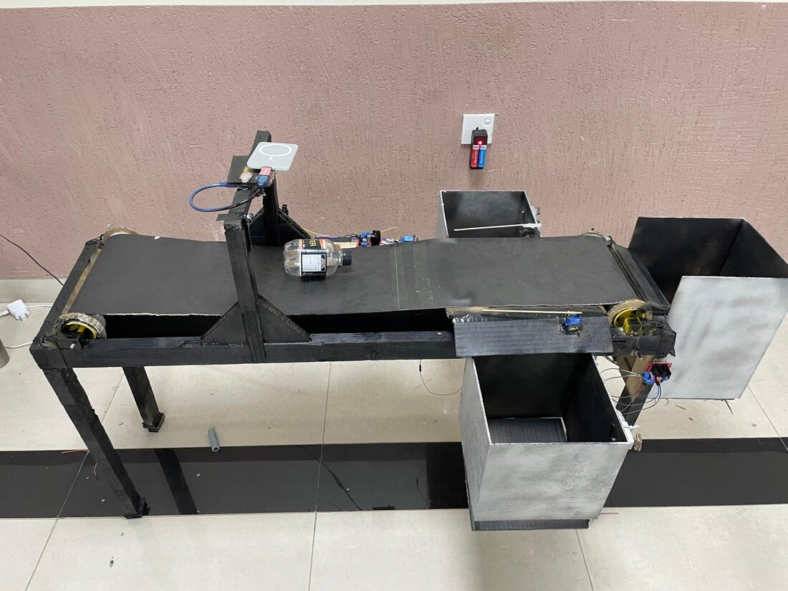
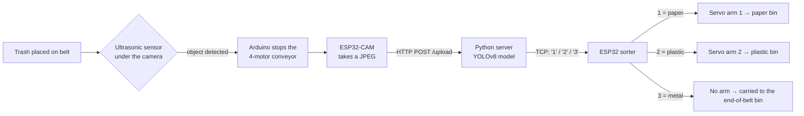
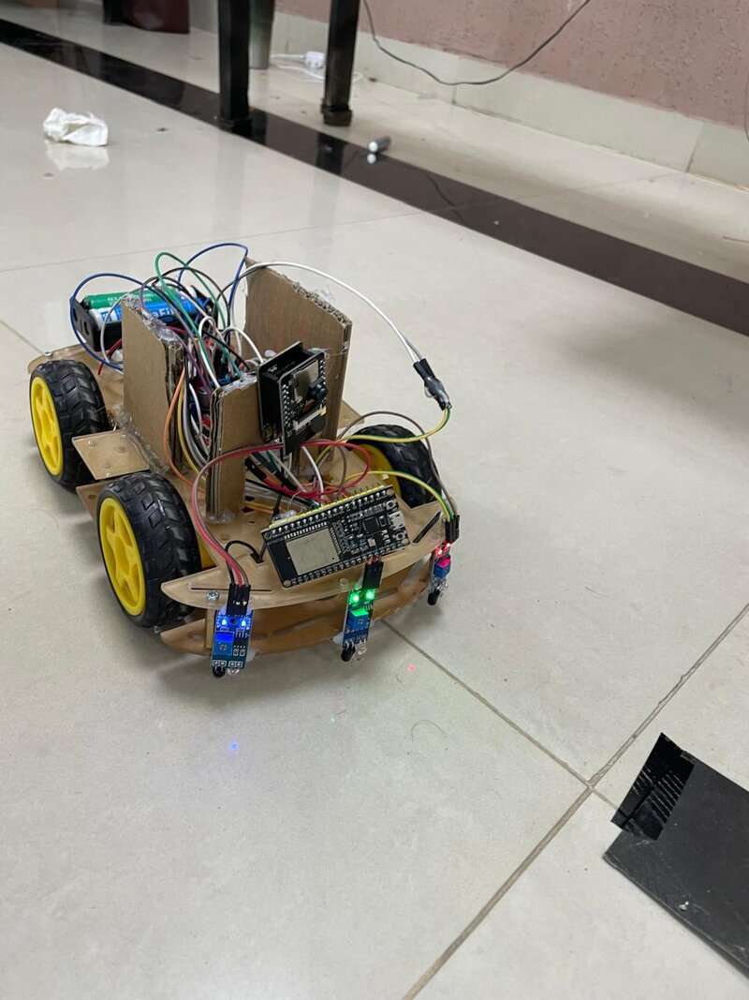
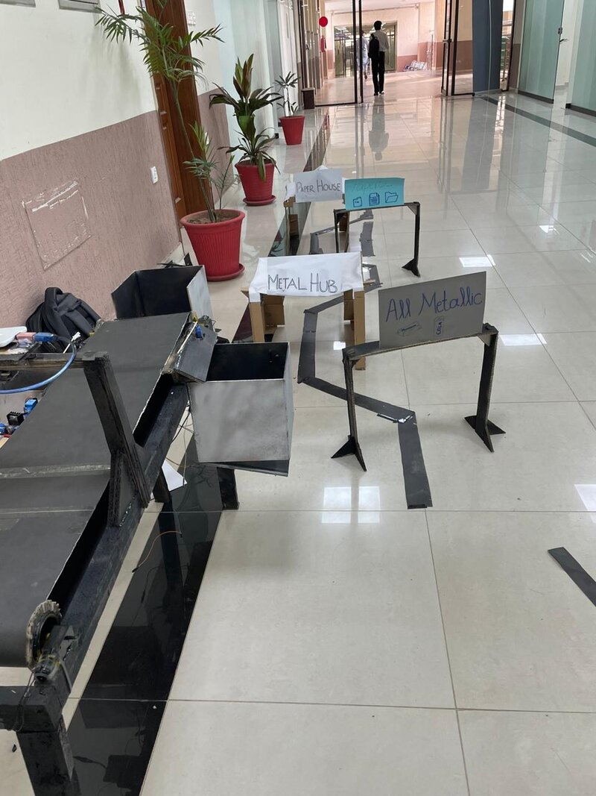
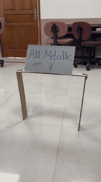
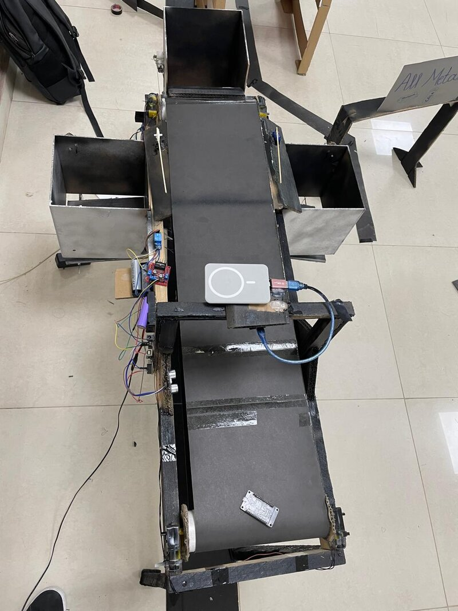
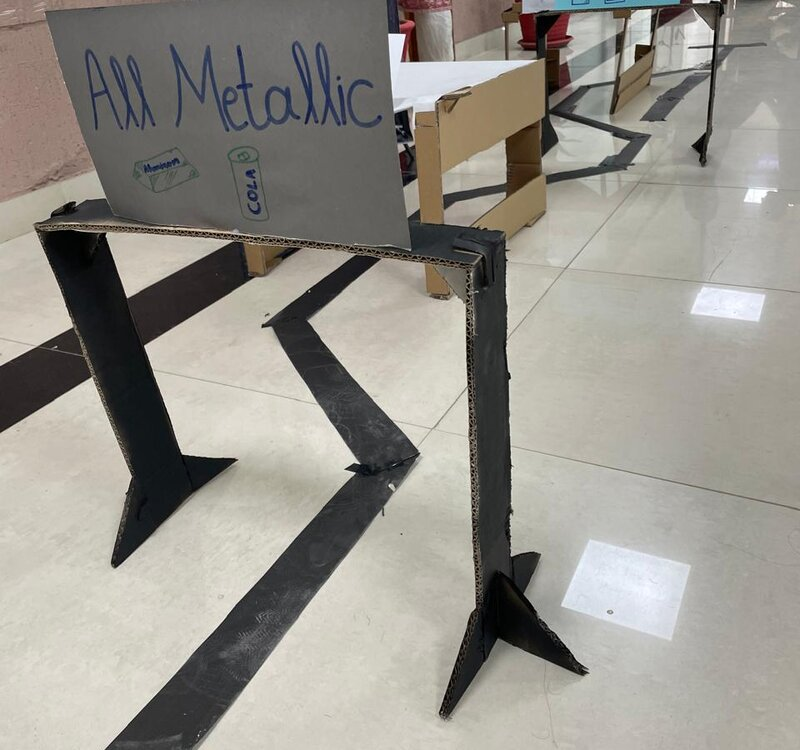
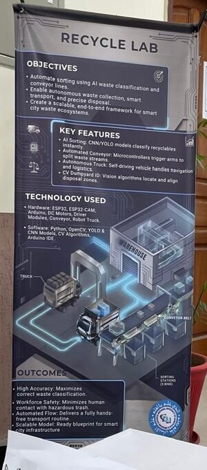

# ♻️ Recycle Lab – AI Waste-Sorting Conveyor + Autonomous Collection Truck

An end-to-end smart-recycling prototype that combines **computer vision (YOLOv8)**, **IoT microcontrollers (ESP32, ESP32-CAM, Arduino)** and **robotics**. We built it for our **Artificial Intelligence** course at FAST-NUCES Islamabad.

The system has two parts:

1. **Sorting station:** a conveyor belt with a camera. A YOLOv8 model classifies each piece of trash as **paper, plastic or metal**, and servo arms push it into the matching bin.
2. **Collection truck:** a rover you can drive by remote control over Bluetooth, or switch to line-following mode to drive itself around a model city. Its own camera reads the signs at junctions so it can find the right drop-off yard.

<p align="center">
  <br>
  <em>The sorting station: ESP32-CAM on the overhead bridge, servo-driven sorting arms, and the three bins</em>
</p>

---

## 🏗️ How It Works

### Part 1: AI sorting station



1. Trash is placed on the belt, which is driven by **4 DC motors** controlled by an Arduino.
2. An **ultrasonic sensor** under the camera bridge detects the item, and the Arduino **pauses the belt**.
3. The **ESP32-CAM** takes a 320×240 JPEG every 2 seconds and POSTs it to the laptop.
4. The **Python server** runs the YOLOv8 model, picks the most confident detection, and sends one character to the ESP32 sorter over a raw TCP socket: `1` for paper, `2` for plastic, `3` for metal.
5. The **ESP32 sorter** swings the matching servo arm across the belt for 8 seconds, so the item is pushed into its side bin, and then resets it. It also holds a status pin HIGH while it's sorting.
6. A second **Arduino under the bins** watches 3 ultrasonic sensors. When the truck parks under a bin, it opens that bin's flap so the trash drops in. The sequence is open for 3.5 s, wait 5 s, close for 4.5 s, then a 30 s lockout.

### Part 2: autonomous collection truck

<p align="center">
  
  <br>
  <em>Left: the truck (ESP32, 3 IR sensors, motor driver, ESP32-CAM). Right: the model city with junction drop-off yards</em>
</p>

- **Two ESP32 boards on the truck.** An **ESP32** drives the motors, and an **ESP32-CAM** on top streams live MJPEG video to the laptop.
- **Manual mode (Bluetooth RC).** You connect to `ESP32_Dual_Car` from a phone Bluetooth controller app and drive with `F` / `B` / `L` / `R` / `S`. In this mode you drive the truck under each bin to collect its sorted trash.
- **Line-following mode.** Press `W` to switch modes. The truck then follows the black tape city using **3 IR sensors** (left, centre and right). It stops automatically when all three see black, the "end box", and drops back to manual mode.
- **Junction decisions with computer vision.** Signs such as **"All Metallic"**, **"Paperti…"** and **"Metal Hub"** mark the drop-off yards at each junction. The ESP32-CAM stream is fed to a Python script on the laptop. When the camera recognises the yard that matches the truck's load, the truck turns into that junction instead of carrying straight on.

<p align="center">
  <br>
  <em>Approaching the "All Metallic" junction from the truck's height</em>
</p>

## 🧠 The Model

| | |
|---|---|
| Architecture | **YOLOv8n** (object detection), fine-tuned from `yolov8n.pt` |
| Classes | `metal`, `paper`, `plastic` |
| Training | 30 epochs, 640 × 640 images, batch 16 (Google Colab) |
| Validation | precision **0.999**, recall **1.0**, mAP50 **0.995**, mAP50-95 **0.995** |
| File | [`models/recycle_yolov8n.pt`](models/recycle_yolov8n.pt) (6 MB) |

The server also accepts a YOLO **classification** model. It reads `probs` when they're present and falls back to the highest-confidence detection box otherwise. When no object is detected in a frame, it sends **no** command, so an empty belt never triggers the servos.

## 🔌 Hardware

| Component | Used for |
|---|---|
| ESP32-CAM (AI-Thinker) ×2 | Belt camera (HTTP upload) and truck camera (MJPEG stream) |
| ESP32 ×2 | Servo sorter (TCP server); truck controller (Bluetooth + line follower) |
| Arduino ×2 | Conveyor motor control; bin-flap controller |
| HC-SR04 ultrasonic sensors ×4 | 1 belt-stop sensor + 3 truck-detection sensors under the bins |
| DC motors + motor drivers | 4-motor conveyor, bin flaps, 4WD truck chassis |
| Servo motors ×2 | Sorting arms for the paper and plastic bins |
| IR line sensors ×3 | Truck line following |

## 📁 Repository Structure

```
.
├── sorting-station/
│   ├── classifier_server/          # Python: receives images, runs YOLOv8, sends commands
│   │   ├── server.py
│   │   └── requirements.txt
│   ├── esp32_cam_capture/          # ESP32-CAM: POSTs a JPEG every 2 s
│   ├── sorter_servo_controller/    # ESP32: TCP server on :80, moves servo arms
│   └── bin_flap_controller/        # Arduino: 3 ultrasonic sensors → bin flap motors
├── truck/
│   ├── truck_controller/           # ESP32: Bluetooth RC + IR line follower (W toggles modes)
│   └── truck_camera_stream/        # ESP32-CAM: MJPEG live stream at /video
├── models/
│   └── recycle_yolov8n.pt          # Trained YOLOv8n weights
└── media/                          # Photos, demo GIF, videos
```

## 🛠️ Setup

### 1. Python classifier server
```bash
cd sorting-station/classifier_server
pip install -r requirements.txt
python server.py          # listens on port 8000
```
In `server.py`, set `ESP_IP` to the sorter ESP32's IP address. The default is the static IP `192.168.43.122`.

### 2. Microcontrollers (Arduino IDE)
- Install the **ESP32 board package** and the **ESP32Servo** library.
- In each ESP sketch, replace `YOUR_WIFI_SSID` / `YOUR_WIFI_PASSWORD` with your network. All the devices and the laptop must be on the **same Wi-Fi or hotspot**.
- In `esp32_cam_capture.ino`, set `serverURL` to `http://<laptop-ip>:8000/upload`.
- In `sorter_servo_controller.ino`, adjust the static IP and gateway to fit your network's subnet.
- Upload each sketch to its board. The ESP32-CAM sketches use the **AI Thinker ESP32-CAM** board setting.

### 3. Pin summary
| Board | Pins |
|---|---|
| Sorter ESP32 | Servo 1 → GPIO 13, Servo 2 → GPIO 14, status → GPIO 12 |
| Bin-flap Arduino | Ultrasonic sensors: trig/echo on 2/3, 4/5, 6/7 · flap motor pairs: 8/9, 10/11, 12/13 |
| Truck ESP32 | IR sensors: 34 (L), 35 (C), 32 (R) · motor driver: IN1–IN4 on 14/27/26/25, ENA 33, ENB 23 |

## ⚠️ Not Included

These parts were used in the final demo, but their source code has been lost:
- **Conveyor-belt Arduino sketch:** stopping the 4 motors when the ultrasonic sensor detects an item.
- **Truck junction-recognition script:** the laptop-side Python that reads the truck camera's MJPEG stream and makes the turn decision. The included `truck_controller.ino` is the version that was recovered. In line-following mode it takes the first left branch once, then follows the line.

## 📸 Gallery

| Conveyor (top view) | Junction sign | Project poster |
|---|---|---|
|  |  |  |

More footage from the truck's point of view: [`media/videos/`](media/videos/)

## 👥 Team

- **Muhammad Huzaifa**
- *Teammate name*
- *Teammate name*
